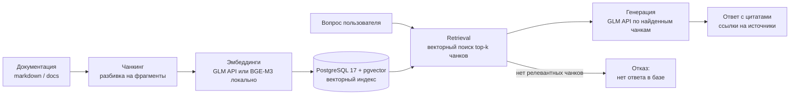

# Архитектура

RAG-конвейер: от сырой документации до ответа с цитатами.

## Этапы

1. **Ингест** — markdown/docs скачиваются и разбираются на чанки
   с сохранением источника (файл, раздел, якорь).
2. **Чанкинг** — разбивка по заголовкам/размеру окна с перекрытием.
3. **Эмбеддинги** — GLM API (`EMBEDDINGS_PROVIDER=glm`)
   или локально BGE-M3 на RTX 5060 Ti (`EMBEDDINGS_PROVIDER=local`).
4. **Хранение** — PostgreSQL 17 + pgvector, векторный индекс (HNSW/IVFFlat).
5. **Retrieval** — top-k релевантных чанков по эмбеддингу вопроса.
   Если релевантность ниже порога — отказ «нет ответа в базе».
6. **Генерация** — GLM API (OpenAI-совместимый) отвечает строго
   по найденным чанкам и цитирует источники.

## Границы решения

- Источники: только открытая документация (PostgreSQL, Spring Security docs).
- Ответ всегда сопровождается ссылкой; без источника — отказ.
